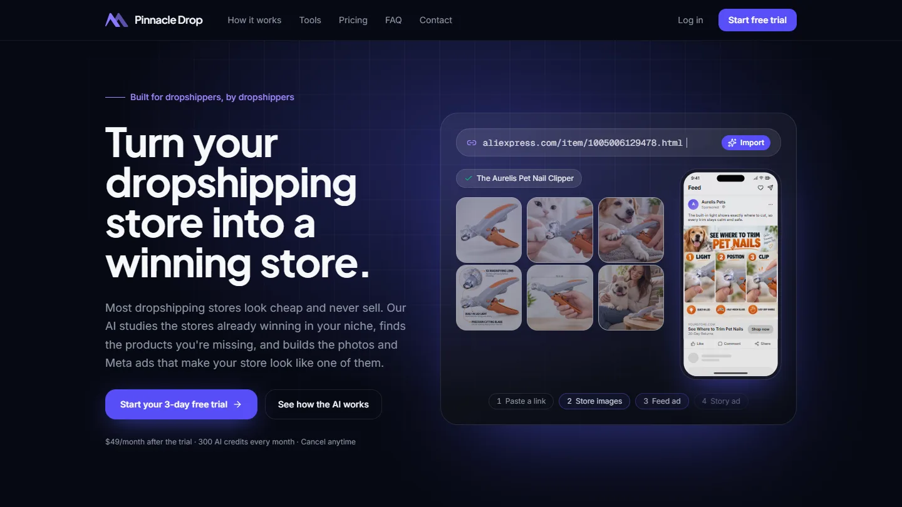
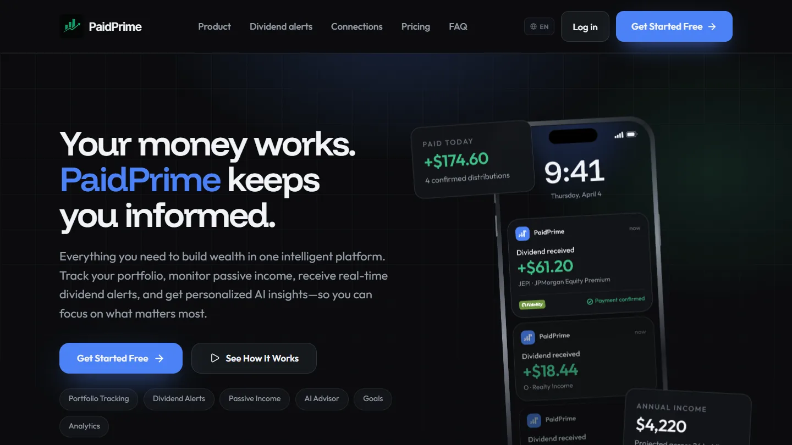
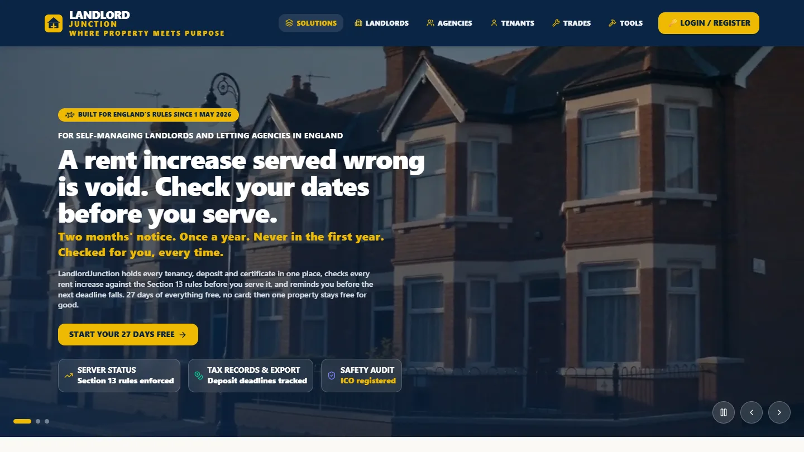
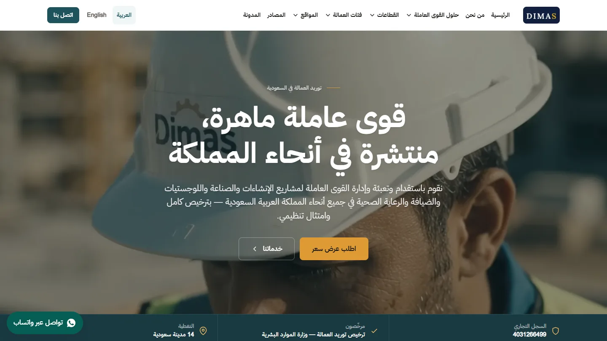

# Mohammad Shuja Uddin

**Your AI-built app works in the demo. I make it work for real users.**

Next.js + Supabase developer · Co-founder of [Orvex Labs](https://www.orvexlabs.io) · Islamabad, Pakistan

  
  
  
  
  
  

---

### What I do

- **Fix AI-built apps.** Lovable, Bolt, Cursor and Replit apps that break with real users: sign-in loops, Stripe payments that never confirm, missing row-level security, exposed keys, failed deploys.
- **Build SaaS MVPs.** Next.js and Supabase with auth, access rules, Stripe subscriptions and an admin view, on accounts the client owns.
- **Add AI features.** OpenAI, Gemini or Claude inside an existing app, and chatbots that answer from your own documents with sources (RAG on Supabase pgvector).
- **Build CMS sites.** WordPress to Next.js + Sanity migrations, multi-language and Arabic right-to-left sites.

Clients rate the work **5.0 across 7 five-star reviews** on Upwork and Fiverr.

> "Was able to fix some bugs in a short time that other devs weren't able to fix in a week."
> — Upwork client, 5-star review

---

### Client work (all live)

<table>
  <tr>
    <td width="50%" valign="top">
      
      <h4>Find Your Cooking Class</h4>
      
A Lovable prototype that couldn't take a booking, rebuilt into a two-sided marketplace: Stripe Connect payments confirmed by webhooks, a host dashboard, a 12-module admin and real-time chat.

      React · Supabase · Stripe Connect · Realtime 
      <a href="https://www.findyourcookingclass.com/">Live site</a> · <a href="https://www.shuja.app/projects/cooking-marketplace">Case study</a>
    </td>
    <td width="50%" valign="top">
      
      <h4>Pinnacle Drop</h4>
      
AI ad-creation SaaS for dropshippers: a supplier product link becomes store images and a complete Meta ad, sold on monthly AI credits.

      Next.js · Supabase · OpenAI · Stripe 
      <a href="https://pinnacledrop.com/">Live site</a> · <a href="https://www.shuja.app/projects/pinnacle-drop">Case study</a>
    </td>
  </tr>
  <tr>
    <td width="50%" valign="top">
      
      <h4>PaidPrime</h4>
      
Dividend-tracking PWA that alerts investors by push, Telegram and email, with Plaid broker sync and paid Stripe tiers.

      Next.js · Supabase · Stripe · Plaid 
      <a href="https://paidprime.com/">Live site</a> · <a href="https://www.shuja.app/projects/paidprime">Case study</a>
    </td>
    <td width="50%" valign="top">
      
      <h4>Landlord Junction</h4>
      
Six-role UK property platform. I connected the React frontend to the client's Supabase backend across three phases, one reviewed pull request at a time.

      React · Supabase · TypeScript 
      <a href="https://landlord-junction.vercel.app/">Live site</a> · <a href="https://www.shuja.app/projects/landlord-junction">Case study</a>
    </td>
  </tr>
  <tr>
    <td width="50%" valign="top">
      
      <h4>Climbing Kilimanjaro Tanzania</h4>
      
A hacked WordPress site (319 of 323 posts were spam) rebuilt in Next.js, moved into Sanity and extended to four languages.

      Next.js · Sanity · i18n 
      <a href="https://climbingkilimanjarotanzania.com/">Live site</a> · <a href="https://www.shuja.app/projects/kilimanjaro-nextjs-sanity">Case study</a>
    </td>
    <td width="50%" valign="top">
      
      <h4>DIMAS</h4>
      
Arabic-first, right-to-left corporate site with a full English version and an embedded Sanity Studio, shipped in four paid phases.

      Next.js · Sanity · RTL 
      <a href="https://dimasgcc.com/">Live site</a> · <a href="https://www.shuja.app/projects/dimasgcc">Case study</a>
    </td>
  </tr>
</table>

---

### Final-year project: InteGrow

A Windows desktop app where **26 specialised AI agents** take software from plain-English requirements to UML, code, tests and deployment configs, committing every artifact to GitHub. Built with Muskan Tariq and Amna Hassan at FAST NUCES, supervised by Dr. Muhammad Bilal.

Electron · Next.js · FastAPI · Supabase · Llama 3.3 70B · [integrow-landing.vercel.app](https://integrow-landing.vercel.app/)

---

### Stack

| Area | Tools |
|------|-------|
| **Apps** | Next.js, React, TypeScript, Node.js, Python, FastAPI |
| **Data** | Supabase (PostgreSQL, auth, row-level security, pgvector), MongoDB |
| **Payments** | Stripe (Checkout, Connect, subscriptions, webhooks) |
| **AI** | OpenAI API, Gemini, LangChain, RAG |
| **CMS** | Sanity, headless WordPress migrations |
| **Shipping** | Vercel, Railway, Docker, GitHub Actions |

---

### Experience

**Co-founder** — [Orvex Labs](https://www.orvexlabs.io)
Full-stack builds and fixes for clients, delivered in milestones with staging links and pull requests.

**Freelance Full-Stack Developer** — Upwork and Fiverr *(2024 – now)*
App rescues, SaaS products and multi-phase platform work, rated 5.0 by clients on both platforms.

**Software Developer Intern** — Islamic Manpower Promoters *(Jun 2025 – Aug 2025)*
- Developed and tested backend services using NestJS and Jest
- Implemented process automation workflows using n8n and contributed to an ERP system
- Integrated new features and resolved bugs in an agile team

**Full Stack Developer Intern** — Craftlab *(Jun 2024 – Aug 2024)*
- Built a client dashboard with React and integrated REST APIs for real-time order tracking
- Developed a reusable UI component library and responsive layouts
- Wrote automated tests and helped set up staging deployments with GitHub Actions

**BS Software Engineering** — FAST NUCES, Islamabad *(2022 – 2026)*

---

  

  Got an app that breaks with real users? <a href="https://www.shuja.app/contact#send-app-link"><strong>Send me the link</strong></a> and you'll hear back within 24 hours.

